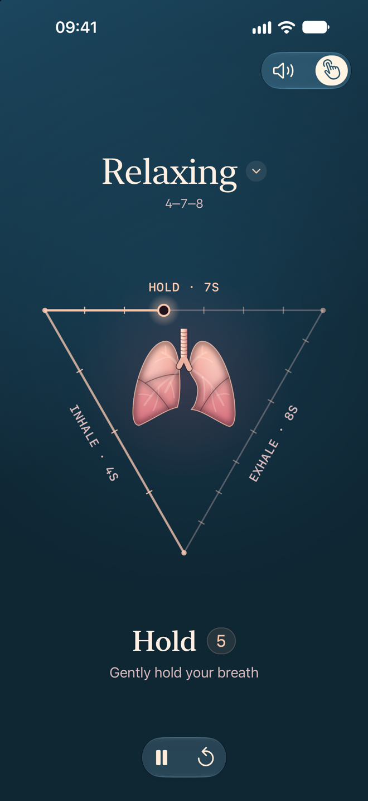
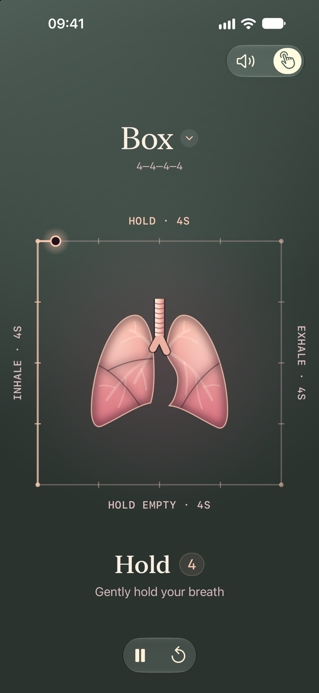
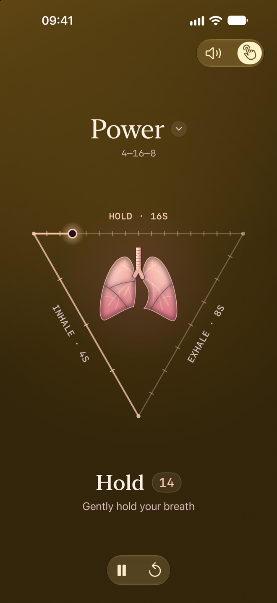

  

<h1 align="center">BreathTrace</h1>

  <strong>Guided breathing patterns for iPhone, iPad, Apple Watch and Mac.</strong> 
  Follow a calm shape, hear each breath and feel it on your wrist.

  <a href="https://emkinter.github.io/BreathTraceApp/">Website</a> ·
  <a href="https://emkinter.github.io/BreathTraceApp/support.html">Support</a> ·
  <a href="https://emkinter.github.io/BreathTraceApp/privacy.html">Privacy Policy</a> ·
  <a href="https://emkinter.github.io/BreathTraceApp/disclaimer.html">Medical Disclaimer</a>

  
  &nbsp;
  
  &nbsp;
  

## About the app

BreathTrace guides your breathing with a shape you can follow at a glance. A marker traces an oval, a triangle or a square while a pair of lungs fills and empties in time, so you always know whether to breathe in, hold or breathe out, and for how long.

BreathTrace is coming soon to the App Store.

### Patterns

| Pattern | Timing | What it is |
| --- | --- | --- |
| **Relaxing** | 4–7–8 | A long, slow breath out for winding down. |
| **Triangle** | 4–4–4 | An even inhale, hold and exhale. |
| **Box** | 4–4–4–4 | Four equal sides, including a hold with empty lungs. |
| **Long exhale** | 4–6, 4–8 or 3–1–7–1 | Breathe out for longer than you breathe in. |
| **Power** | 1 : 4 : 2 | Inhale for one count, hold for four, exhale for two, with a count of 3, 4, 5 or 8 seconds. |

### Features

- **See it.** A countdown and a plain instruction for every phase, and a background color for each pattern.
- **Hear it.** Breath sounds that last exactly as long as each phase, a soft gong at every change and a quiet tick on every second. One button mutes them all.
- **Feel it.** Haptic taps on iPhone and Apple Watch that quicken and strengthen as you inhale, then slow and soften as you exhale.
- **Keep going.** Sounds continue with the iPhone locked, and a session carries on with your wrist down on Apple Watch.
- **Ask about it.** On devices with Apple Intelligence, a conversation about the pattern you are using, answered on the device.
- **Accessible.** Works with VoiceOver, larger text sizes and Reduce Motion.
- **Private.** No account, no ads, no network requests and no data collected.

## Support

Read the [support page](https://emkinter.github.io/BreathTraceApp/support.html) for answers to common questions.

If you found a problem or have a suggestion, [open an issue](https://github.com/emkinter/BreathTraceApp/issues/new). Mention your device, its software version, and what you did before the problem appeared. Issues are public, so please leave out personal or health information.

## Medical disclaimer

BreathTrace is a breathing timer, not a medical device, and nothing in it is medical advice. If a pattern makes you dizzy or uncomfortable, stop and breathe normally. Read the [full disclaimer](https://emkinter.github.io/BreathTraceApp/disclaimer.html).

## About this repository

This repository holds BreathTrace's public website, which GitHub Pages publishes from the `main` branch at <https://emkinter.github.io/BreathTraceApp/>. The app's source code is not part of it.

| File | Page |
| --- | --- |
| `index.html` | Product page |
| `support.html` | Support and frequently asked questions |
| `privacy.html` | Privacy policy |
| `disclaimer.html` | Medical disclaimer |
| `styles.css` | The styles all pages share |
| `assets/` | App icon and screenshots |
| `.nojekyll` | Tells GitHub Pages to publish the files as they are |

The pages are plain HTML and CSS with no build step. To preview a change, open `index.html` in a browser; pushing to `main` publishes it.

## License

© 2026 Ekkehard Koch. The contents of this repository are licensed under the GNU General Public License v3.0; see [LICENSE](LICENSE).

Apple, iPhone, iPad, Apple Watch, Mac and App Store are trademarks of Apple Inc.
